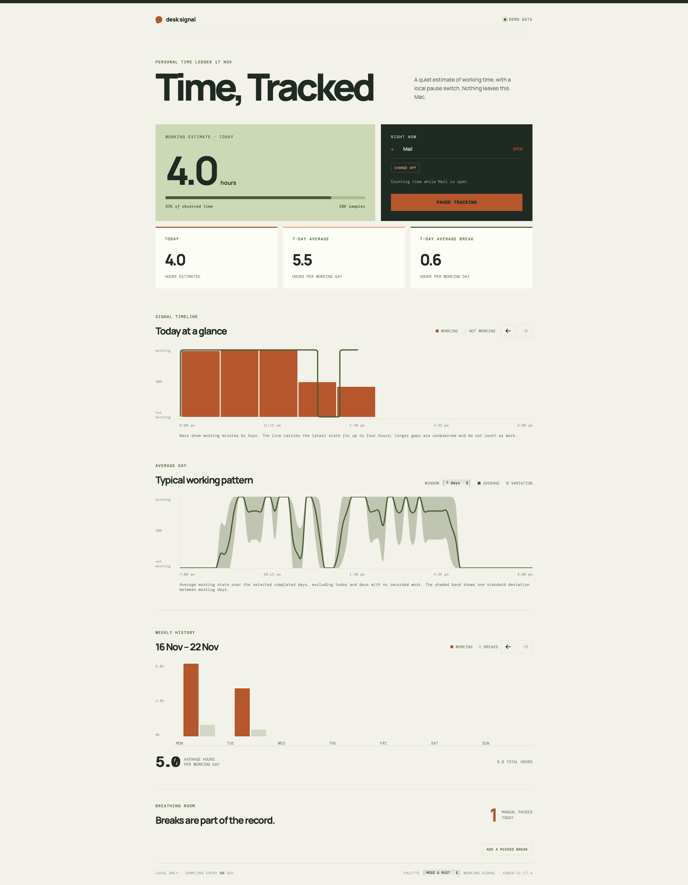

# Desk Signal

A private, lightweight working-hours tracker for macOS. Once a minute it checks whether your work app (Mail by default) is running and turns that into daily, weekly and average working hours. Everything stays on your Mac.



## Getting started

Build and start the menu-bar app:

```sh
./build_menubar_app.sh
nohup build/DeskSignal.app/Contents/MacOS/DeskSignal > /tmp/DeskSignal.log 2>&1 </dev/null &
```

A **TT** icon appears in the menu bar and starts the tracker. Choose **Open dashboard** there, or go to http://127.0.0.1:8765. The app is unsigned, so macOS may ask you to confirm the first launch.

Without the menu-bar app, run the tracker on its own:

```sh
nohup python3 tracker.py > /tmp/DeskSignal-tracker.log 2>&1 </dev/null &
```

Stop it with `pkill -f '[p]ython3 tracker.py'`. Run only one of the two; both use port 8765.

## Using it

- **Choose the work app:** click **Change app** in the dashboard and enter the app's process name (e.g. `Mail`, `Zulip`, `Code`). Time counts while that app is running, whether or not it is in the foreground.
- **Pause:** use **Pause tracking** in the **TT** menu or the button on the dashboard. When you resume, you choose whether the pause was a break or should count as work.
- **Add a missed break:** forgot to pause? Use **Add a missed break** at the bottom of the dashboard to enter a start and end time for today.
- **Browse:** the arrows step through past days and weeks; the **Average day** chart covers 7, 14, 30 or 90 days, or all history. The footer has a **Palette** selector for the color scheme.

## Good to know

- Data is stored in the `data/` folder of the project (ignored by git).
- Gaps of more than four hours without samples (e.g. the Mac was asleep) never count as work.
- If the footer says `restart tracker` after an update, stop the tracker and start it again.
