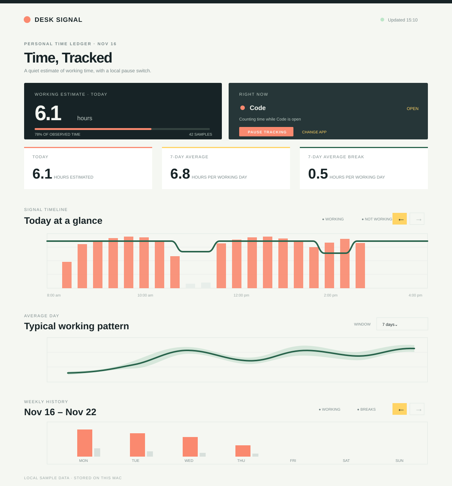
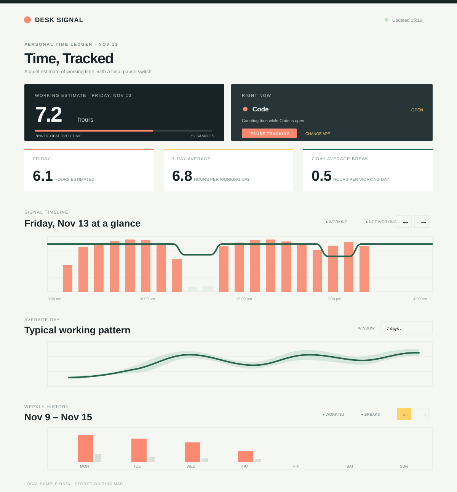

# Desk Signal

A private, lightweight macOS working-hours estimator. It samples whether your working signal is active, then reports daily totals and a seven-day average.

Use the **Pause tracking** button when you step away from work. The pause state is stored locally in `data/pause.json` and applies to future samples until resumed.

If you forgot to pause, use **Add a missed break** at the bottom of the dashboard. Enter start and end times for today; the correction is saved in the local sample history and reflected in the daily and weekly totals.

The dashboard carries each sample's working state for up to four hours. Longer gaps are unobserved and do not count as work, so a stale app process cannot count an entire day as working time. Pause tracking before stepping away to mark a break explicitly.

Use the arrows beside **Signal timeline** to browse days with recorded work. Open **Change app** in the **Right now** panel to choose a different app process as the work signal. The tracker checks whether that process is running; it does not detect whether the app is in the foreground.

## Example views

These example dashboard views are illustrations with sample values.





## Menu-bar app

Build the local macOS controller:

```sh
./build_menubar_app.sh
nohup build/DeskSignal.app/Contents/MacOS/DeskSignal > /tmp/DeskSignal.log 2>&1 </dev/null &
```

Use the detached command above rather than running the executable in the foreground: the menu-bar app will keep running after the Terminal window closes. It starts the local tracker automatically and reuses an existing tracker if one is already listening on port 8765. On Intel Macs, the app uses `/usr/local/bin/python3`; on Apple Silicon, it uses `/opt/homebrew/bin/python3`.

Check that the tracker is still running:

```sh
curl http://127.0.0.1:8765/api/status
```

The `TT` icon in the menu bar provides **Start tracking**, **Stop tracking**, **Pause tracking**, **Resume tracking**, and **Open dashboard**. Choose the signal app from the dashboard. The app is local and unsigned; macOS may ask you to confirm the first launch. No Apple Developer subscription is needed for personal use on this Mac.

## Run tracker only

```sh
nohup python3 tracker.py > /tmp/DeskSignal-tracker.log 2>&1 </dev/null &
```

Open http://127.0.0.1:8765. A foreground tracker stops with `Ctrl-C`; stop the detached tracker with `pkill -f '[p]ython3 tracker.py'`.

Do not start `tracker.py` separately if the menu-bar app is already running; both processes use port 8765.

The default sample interval is 60 seconds. Override it for a quick test:

```sh
TRACK_INTERVAL=10 python3 tracker.py
```

The app stores samples and the selected process name under the ignored `data/` directory. To use an app other than Mail, click **Change app** in the dashboard and enter its exact process name (for example, `Code` or `Xcode`). For a standalone tracker, run `MAIL_APP=Code python3 tracker.py`; a saved dashboard choice takes precedence over that default.
